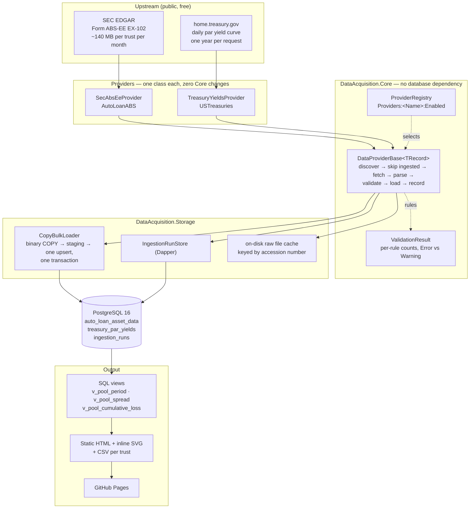

# fixed-income-data-acquisition

[](https://github.com/dheepakkaran/fixed-income-data-acquisition/actions/workflows/ci.yml)

A C#/.NET data acquisition framework for fixed-income data. Two real public providers feed
PostgreSQL, and a static ABS pool performance report comes out the other end: loan-level auto
loan ABS from **SEC EDGAR Form ABS-EE**, benchmarked against the **U.S. Treasury daily par
yield curve**. Adding a provider is a new class and a configuration entry, not a change to the
framework. Every number published is measured, every published figure traces back to the file
it came from, and a performance-regression gate checks each release.

**[Live report](https://dheepakkaran.github.io/fixed-income-data-acquisition/)** ·
[RESULTS.md](RESULTS.md) (measured numbers) · [docs/metrics.md](docs/metrics.md) (every
formula) · [docs/decisions.md](docs/decisions.md) (why things are the way they are)

## Architecture



## Quickstart

Needs the [.NET 10 SDK](https://dotnet.microsoft.com/download/dotnet/10.0) and Docker.

```bash
docker compose up -d                                      # PostgreSQL 16 on host port 55432
dotnet run --project src/DataAcquisition.Cli -- migrate   # apply db/migrations
dotnet run --project src/DataAcquisition.Cli -- ingest     # fetch, parse, validate, load
dotnet run --project src/DataAcquisition.Cli -- report --out ./site
open ./site/index.html
```

`ingest` downloads about 1.2 GB on a cold cache and roughly 316,000 loan-level records land
in about 10 seconds once the files are local. `status` lists recent runs.

```
ingest  [--provider <name>] [--periods <n>] [--subject <cik>] [--force] [--dry-run]
report  [--out <dir>]
status  [--provider <name>] [--limit <n>]
```

Trusts live in [`appsettings.json`](src/DataAcquisition.Cli/appsettings.json), not in code, so
adding one is configuration. See [docs/runbook.md](docs/runbook.md).

## Why each tool is here

Every row earned its place; where a claim is measurable the measurement is in
[RESULTS.md](RESULTS.md).

| Tool | Problem it solves | Measured |
|---|---|---|
| **C# / .NET 10 (LTS)** | The role's platform. LTS is supported to Nov 2028. | SDK 10.0.402 |
| **PostgreSQL 16** (Docker Compose) | A real SQL database that is free, and the same engine in tests, CI and production. | 16.15 locally and in CI |
| **Npgsql binary COPY** | Loan-level files carry tens of thousands of rows per trust per month; row-by-row `INSERT` is too slow. | **429 ms vs 3,814 ms** on 29,152 records — **8.9x** |
| **Dapper** | Keeps data access SQL-first, so the queries behind published numbers stay reviewable. | — |
| **DbUp** (`dbup-postgresql`) | Ordered, versioned SQL applied identically on a laptop, in CI and in production. | 4 migrations |
| **`Microsoft.Extensions.Http.Resilience`** + **`System.Threading.RateLimiting`** | Retries flaky calls, and holds SEC's fair-access ceiling of 10 requests per second. | Ceiling holds; a sliding window did **not** (19 observed in one second) |
| **`System.Xml.XmlReader`** (streaming) | Exhibits reach 160 MB, and one filer emits a single 144 MB line with no newline anywhere. | **1.2 MB** managed heap growth parsing a 116.5 MiB file; 37,263 records/s, 148.9 MB/s |
| **`Microsoft.Extensions.Hosting`** / DI / Logging / Configuration | A provider is a class plus a config entry. | Treasury added with **0 lines changed in Core** |
| **xUnit** + coverlet | Automated tests and coverage in CI. | **168 tests**, 61.1% line coverage |
| **Testcontainers.PostgreSql** | COPY, upserts, partial indexes, check constraints and rollback cannot be trusted against an in-memory fake. | 48 integration tests on real PostgreSQL |
| **BenchmarkDotNet** | Measures the parser, the bulk load and the metric queries, and feeds the gate. | 8 benchmarks |
| **GitHub Actions** | CI on every PR, the perf gate, releases and the monthly production run. | — |
| **GitHub Pages** | Hosts the report for free. This is the production output. | — |
| **gh CLI** | PRs, merges, branch cleanup and releases from the terminal. | 10 PRs |

## What the real filings taught

Each of these was found by downloading files and reading them, and each would have produced a
wrong report or a crash if taken on trust. The full list is
[RESULTS.md section 5](RESULTS.md).

- **Interest rates are decimal fractions, not percentages**, despite every element being named
  `...Percentage`. Treasury yields *are* percentages. Mixing them is a 100x error.
- **`obligorCreditScore` is a string, not an integer.** The literal text `None` appears **182
  times** in one exhibit; a score of `0` is a no-score sentinel on **937 of 38,648** loans.
- **Closed loans stay in the file for months.** In the most seasoned pool only **51%** of
  reported loans still carry a balance.
- **`currentDelinquencyStatus` is days past due, not a bucket code**, and it is optional.
- **Formatting is entirely up to the filing agent** — 2,138,467 lines at one trust, **one line**
  at another.

## Git workflow

Gitflow. `main` is production and only ever receives a release PR from `develop`; `develop`
only receives `feature/*` and `fix/*`. Both are protected, force pushes blocked, `build-test`
required on both and `perf-gate` required on `main` (15% on allocated memory, 50% on mean time — see D20). Every merge to `main` is tagged and gets a
GitHub Release. Conventional Commits throughout; every PR body states **What**, **Why**, **How
tested** and **Output**.

```
feature/*  ──PR──▶  develop  ──release PR──▶  main  ──tag──▶  GitHub Release
                                                      │
                                                      └──▶  production run ──▶  Pages
```

## Repository layout

```
src/DataAcquisition.Core/                 abstractions, pipeline, run tracking
src/DataAcquisition.Storage/              DbUp runner, Dapper repos, COPY bulk loader
src/DataAcquisition.Providers.SecAbsEe/   SEC EDGAR ABS-EE (auto loan ABS)
src/DataAcquisition.Providers.TreasuryYields/
src/DataAcquisition.Reports/              SQL readers, HTML and SVG, CSV
src/DataAcquisition.Cli/                  migrate · ingest · report · status
tools/PerfGate/                           compares benchmarks with a baseline
benchmarks/DataAcquisition.Benchmarks/
tests/{UnitTests,IntegrationTests,fixtures}/
db/migrations/                            0001_… 0004_…
docs/                                     architecture · metrics · adding-a-provider · runbook · decisions
.github/workflows/                        ci · release · production-run · capture-baseline
```

## Documentation

| Document | What it covers |
|---|---|
| [docs/architecture.md](docs/architecture.md) | Components, data flow, idempotency, failure handling |
| [docs/metrics.md](docs/metrics.md) | Every formula with the exact field names it reads |
| [docs/adding-a-provider.md](docs/adding-a-provider.md) | Step by step, with Treasury as the worked example |
| [docs/runbook.md](docs/runbook.md) | Rerunning a failed ingestion, backfilling, a red perf gate, adding a trust |
| [docs/decisions.md](docs/decisions.md) | 19 decisions, each with the alternative rejected |
| [RESULTS.md](RESULTS.md) | Measured numbers only |

Coverage is 61.1% of 4,394 coverable lines, merged across both suites rather than summed —
both reports measure the same lines, so adding them reports a misleadingly different number.
It is uneven by design: `DataAcquisition.Reports` is 88.2% and `Core` 76.9%, while the
provider assemblies sit near 47% because much of what is left is the EDGAR and Treasury HTTP
paths, which would need live network calls to cover, and DI registration.

## Data sources and attribution

Both sources are public and free. SEC requests are made with a declared User-Agent naming a
real person and a reachable address, and are paced below 10 requests per second as
[SEC fair access](https://www.sec.gov/os/webmaster-faq#developers) requires. Downloads are
cached on disk so an unchanged exhibit is fetched once.

The indicative spread in the report is a simplified metric and is labelled as such everywhere
it appears. It is not investment advice.
